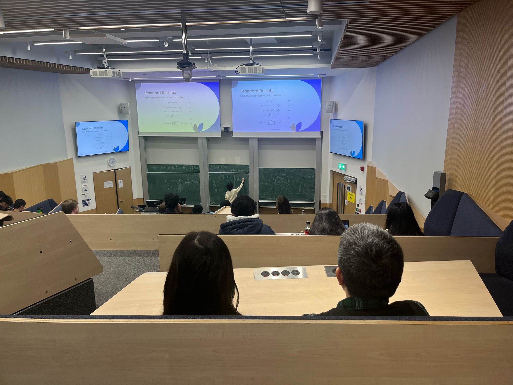

# Presentations & conferences
- *SEPnet London Expo* - 2026.
  > Presented a poster on my summer research, to people across industries and academics.
- **Talk on Emmy Noether** — 2026.
  > Presented a talk on Emmy Noether to an audience of undergraduates and academic staff, as part of Women and Non-Binary People in Physics seminar.
- **'Gravity, Entanglement, and Entropy' Conference** — 2026
- **'QUIRK+' Conference for Undergraduates** — 2026
- **QUIRK Conference for Undergraduate Research** — 2025.
  > Presented research on Fractional Calculus and its applications in Physics.
- **Women and Non-Binary People in Physics Seminar** — 2025.
  > Presented summer research to an audience of over 40 students and academic staff.
- **Conference for Undergraduate Women and Non-Binary Physicists (CUWiP+)** — 2025

{ .inset }
